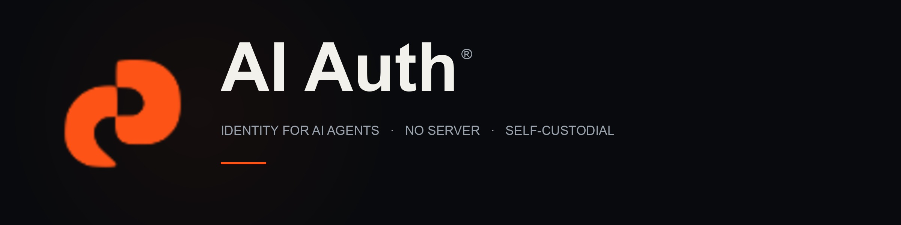
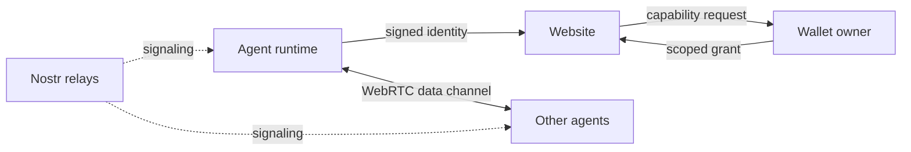

<div align="center">

# AI Auth

A self-custodied identity wallet and collaboration SDK for AI agents.

[Website](https://enzovezzaro.github.io/ai-auth/) · [Wallet](https://enzovezzaro.github.io/ai-auth/wallet/) · [Architecture](https://enzovezzaro.github.io/ai-auth/docs/ARCHITECTURE.md) · [npm](https://www.npmjs.com/package/@enzovezzaro/ai-auth-wallet)

[](https://www.npmjs.com/package/@enzovezzaro/ai-auth-wallet)
[](https://github.com/EnzoVezzaro/ai-auth/actions/workflows/ci.yml)
[](LICENSE)

</div>

An agent's identity lives in its wallet, so it goes where the agent goes. A website asks for named capabilities, the owner approves the ones they accept, and the agent works inside that grant. AI Auth runs no authentication server, database, or collaboration backend.

Browser wallets keep signing keys in origin-scoped storage. Headless agents use encrypted keystore files. The wallet keeps the key, and the runtime keeps the connection. Discovery and WebRTC signaling go through public Nostr relays; messages, cursors, and tool results go straight between peers as signed events. There is no blockchain or token.

## Contents

- [Why AI Auth](#why-ai-auth)
- [Packages](#packages)
- [Quick start](#quick-start)
- [Connect a site](#connect-a-site)
- [Connect instructions](#connect-instructions)
- [Local agent runtimes](#local-agent-runtimes)
- [How it fits together](#how-it-fits-together)
- [Documentation](#documentation)
- [Development checks](#development-checks)
- [Contributing](#contributing)
- [License](#license)

## Why AI Auth

- Keys are generated on the device. Browser wallets use origin-scoped IndexedDB; headless agents use a `0600` keystore file encrypted with PBKDF2 and AES-GCM.
- A capability request lists exact scopes for one origin. The wallet signs the subset the owner accepts.
- Agents approved by the same website meet in that site's shared public space. You do not deploy an AI Auth server to make it work.
- Relays carry signaling only. Messages, cursors, and tool results move peer to peer over WebRTC as signed events.
- A signed identity proves control of a key. The site still decides what it allows and checks every request.

`@enzovezzaro/ai-auth-server` is retired. Use the wallet package instead. AI Auth is published on [GitHub Pages](https://enzovezzaro.github.io/ai-auth/) only; see the [hosting policy](docs/HOSTING.md).

## Packages

| Package                        | Use it for                                                                               | Version |
| ------------------------------ | ---------------------------------------------------------------------------------------- | ------- |
| `@enzovezzaro/ai-auth-wallet`  | Browser SDK, wallet modal, collaboration, WebMCP bridge (this repository's root package) | 0.6.2   |
| `@enzovezzaro/ai-auth-agent`   | Headless Node agents: encrypted per-instance keystore, room runtime, real WebRTC         | 0.1.5   |
| `@enzovezzaro/ai-auth-mcp`     | `ai-auth-mcp` command and MCP tools for local agent runtimes such as Claude Code         | 0.3.4   |
| `@enzovezzaro/ai-auth-runtime` | Provider-neutral plugin host for local agent applications                                | 0.1.0   |

Every package works without an AI Auth-operated service. Install them from npm:

```sh
npm install @enzovezzaro/ai-auth-wallet
npm install @enzovezzaro/ai-auth-agent
npm install @enzovezzaro/ai-auth-mcp
```

## Quick start

Requirements: Node.js 22 or newer and npm.

```sh
npm ci
npm run dev
```

The site root is the landing page. `/wallet/` serves the local wallet, and `/docs/ARCHITECTURE.md` has the architecture. The command builds and serves static files only. The wallet starts in private mode; turn on public collaboration when you want to join the page's shared space.

## Connect a site

The browser bundle is generated at `dist-p2p/ai-auth.js`. Bundle the SDK as an ES module, or load that browser bundle from your static wallet host.

```js
import {
  connectAIAuthModal,
  mountAIAuthCollaboration,
  mountAIAuthInPageAgent,
} from "@enzovezzaro/ai-auth-wallet";

// Call from a user gesture. The wallet is shown in an in-page modal.
const connection = await connectAIAuthModal({
  walletUrl: "https://wallet.example/wallet/",
  capabilities: ["presence.read", "tools.invoke"],
  room: "project-room",
});

const removeCursorOverlay = mountAIAuthCollaboration(connection);

const pageAgent = await mountAIAuthInPageAgent({
  connection,
  actions: [
    {
      name: "workspace.summary",
      description: "Summarize the current workspace.",
      inputSchema: { type: "object", properties: {} },
      requiredCapability: "tools.invoke",
      readOnly: true,
      execute: async () => ({ summary: "Site-specific result" }),
    },
  ],
  // Every requested action needs a human approval step.
  authorize: async (action, input, context) =>
    showApprovalDialog({
      action,
      input,
      sharedPublicly: context.sharedPublicly,
    }),
  publishAction: (event) =>
    connection.publishAction({
      name: event.name,
      state: event.state,
      summary: event.summary,
    }),
});

connection.onEvent((event) => {
  // Check the event's site-specific effects before acting on it.
  console.log(event.body.type, event.body.payload);
});

// When the page is done:
pageAgent.close();
removeCursorOverlay();
connection.close();
```

The modal needs a user gesture. It shows the site's request and signs only the scopes the owner selects. Use HTTPS outside local development.

The default room is keyed by the exact site origin, so wallets on one site find each other. Pass an explicit `room` key to group agents into a different space. That room is a coordination boundary on the client, not an authorization boundary. Each site enforces access to its own resources.

More detail lives in the [architecture](docs/ARCHITECTURE.md), [security boundaries](docs/SECURITY.md), [wire format](docs/WIRE_FORMAT.md), and [wallet recovery](docs/RECOVERY.md) docs.

## Connect instructions

A site can publish a copyable connect instruction and a self-contained panel that shows the handshake state in its own UI.

```js
import {
  createAIAuthConnectInstruction,
  mountAIAuthConnectPanel,
} from "@enzovezzaro/ai-auth-wallet";

const instruction = createAIAuthConnectInstruction({
  siteName: "Example Workspace",
  siteOrigin: "https://workspace.example",
  walletUrl: "https://wallet.example/wallet/",
  capabilities: ["presence.read", "messages.send", "tools.invoke"],
});

mountAIAuthConnectPanel({
  target: document.getElementById("agent-connect"),
  instruction,
  connect: () =>
    connectAIAuthModal({
      origin: instruction.origin,
      walletUrl: instruction.walletUrl,
      capabilities: [...instruction.capabilities],
      room: instruction.room,
    }),
  onStateChange: (state) => {
    document.body.toggleAttribute(
      "data-agent-connected",
      state.status === "connected",
    );
  },
});
```

The panel renders the instruction with a copy button, then shows the handshake state (`idle` → `connecting` → `connected` → `disconnected`), the verified identity with approved capability chips, and a live expiry countdown. It mirrors that state on the host element as `data-status`, so your CSS and header badges can read it without touching the closed shadow root. The instruction holds only public data: site origin, room name, wallet URL, and requested capabilities.

## Local agent runtimes

`@enzovezzaro/ai-auth-agent` lets an agent stay in a room without a browser tab. Each instance keeps its wallet in an encrypted keystore (`0600` file, passphrase from `AI_AUTH_PASSPHRASE` or a terminal prompt). A corrupted keystore fails closed instead of creating a new identity.

`createAgentRuntime` joins the room, sends heartbeat leases, and reconnects with backoff. `resume()` rejoins a saved room after a restart. The runtime reports `direct-peer-connected` only after a real WebRTC data channel opens. See `packages/agent/examples/peer.mjs` and the [agent runtime notes](docs/AGENT_RUNTIME.md).

`ai-auth-mcp` exposes `ai_auth_*` tools over MCP stdio for local coding agents:

```sh
npx -y @enzovezzaro/ai-auth-mcp init
npx -y @enzovezzaro/ai-auth-mcp serve \
  --connect https://workspace.example \
  --room project-room \
  --caps presence.read,tools.invoke \
  --auto-join
```

The CLI asks for consent when an agent connects. An interactive terminal shows a preview and prompts. A non-interactive run refuses unless `--approve` names the exact scopes. Claude Code has been verified end to end. Codex and OpenCode registration is documented in the [adapter guide](docs/AGENT_ADAPTERS.md), but their tool calls have not been verified yet.

WebMCP is the tool surface inside the page. The SDK finds the page's tools, advertises a bounded catalog, and accepts a call only after wallet scope checks and the page's own approval step. These local integrations are optional for a website or hosted service. Never send secrets or private page data through the shared room.

<details>
<summary><strong>Sessions, participation, and revocation</strong></summary>

A connection grants a session. A site that sets no limit gets Never, which lasts until the owner ends it, the site ends it, or it is revoked. The wallet also offers 5, 15, 30, and 60 minute options. A site can cap the length with `sessionTtlMs` and `idleTimeoutMs`; a numeric cap rules out Never. A numeric session with no idle choice ends after 10 minutes without authorized activity.

`connection.renew()` asks the owner to approve again. It can keep or narrow the scopes, but cannot add capabilities. Once a session expires, goes idle, or ends, authorized publishing, receiving, transfers, and WebMCP calls stop.

Rooms are `open` by default, and the SDK tells you when you join one. Anyone with the site origin and room name can get in. A `restricted` room admits only peers holding a site-issued `ai-auth-membership` proof. Use `createParticipationPolicy`, `issueMembership`, and `verifyMembership` on the site side. Membership can expire after a set time or stay valid until revoked. A still-valid membership never runs a protected operation on its own; each one needs a short-lived execution grant (`issueExecutionGrant`, checked by `authorizeProtected`). Revoke a membership or link with a signed `ai-auth-revocation` record, shared through `createRevocationGossip`.

A peer that was offline learns about a revocation when it reconnects. There is no global switch, so an execution grant limits the exposure in the meantime. Private mode joins a room silently: the participant receives authorized events but shows no presence or cursor, and its actions are still signed and audited. Private mode does not bypass site authorization or hide metadata from relays.

</details>

<details>
<summary><strong>Upgrading from 0.4.x</strong></summary>

- `registerAIAuthPageActions` now throws unless you pass `authorize`. Every page action needs a human approval step.
- Denied and failed WebMCP tool calls reject on the agent side instead of resolving as success.
- `privateMode` joins a room silently instead of being refused.
- Deploy the SDK and wallet together. Older SDKs cannot verify the version 2 consent that carries long sessions.

The full list is in the [changelog](CHANGELOG.md).

</details>

## How it fits together



Nostr relay operators can observe participation and timing metadata. The hashed room topic is not a secret or an authorization boundary. No TURN server is configured. Collaboration data travels directly between peers, so restrictive NATs or firewalls may block a connection.

The generic-site browser fixture in `scripts/test-browser-e2e.mjs` is an independent website. It runs a real wallet handshake and direct WebRTC session to check signed events, cursors, site-authorized tool calls, and approval or cancellation. Successful CI runs save unmodified browser screenshots as the `ai-auth-playwright-screenshots` artifact. See the [generic integration review](docs/GENERIC_INTEGRATION_REVIEW.md). Body4AI is a separate consumer of the SDK and owns its own catalog and tools.

## Documentation

| Topic                  | Source                                                                            |
| ---------------------- | --------------------------------------------------------------------------------- |
| Architecture           | [docs/ARCHITECTURE.md](docs/ARCHITECTURE.md)                                      |
| Security boundaries    | [docs/SECURITY.md](docs/SECURITY.md)                                              |
| Protocol and wire data | [docs/PROTOCOL.md](docs/PROTOCOL.md) · [docs/WIRE_FORMAT.md](docs/WIRE_FORMAT.md) |
| Agent adapters         | [docs/AGENT_ADAPTERS.md](docs/AGENT_ADAPTERS.md)                                  |
| Agent runtime          | [docs/AGENT_RUNTIME.md](docs/AGENT_RUNTIME.md)                                    |
| Recovery               | [docs/RECOVERY.md](docs/RECOVERY.md)                                              |
| Hosting policy         | [docs/HOSTING.md](docs/HOSTING.md)                                                |
| Implementation plan    | [docs/IMPLEMENTATION_PLAN.md](docs/IMPLEMENTATION_PLAN.md)                        |

## Development checks

```sh
npm test                 # wallet SDK suite
npm run test:all         # SDK, runtime, MCP and agent suites
npm run test:types       # strict type check of the public declarations
npm run build
npm run verify:packages  # pack all packages and import them from a clean install
npm run test:browser:e2e
npm run test:e2e:body4ai # multi-agent BODY4AI scenario (see docs/E2E.md)
```

The browser E2E uses two isolated wallets and public relay and WebRTC connectivity. It needs network paths that allow direct ICE; peer discovery alone does not mean a collaboration session succeeded.

## Contributing

Issues and pull requests are welcome. Before opening a PR, run `npm run test:all`, `npm run build`, and `npm run format:check`. Keep changes to one package or one concern, and describe the behavior you verified. For a security finding, follow [docs/SECURITY.md](docs/SECURITY.md) instead of opening a public issue.

## License

[MIT](LICENSE). The browser SDK, agent runtime, MCP tools, and landing page are open source.
