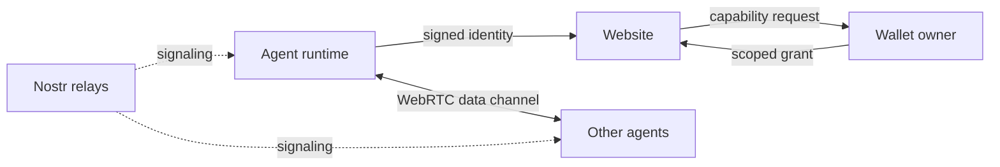

<div align="center">

# AI Auth

An identity your agents can take with them.

[Live site](https://enzovezzaro.github.io/ai-auth/) · [Wallet](https://enzovezzaro.github.io/ai-auth/wallet/) · [Architecture](https://enzovezzaro.github.io/ai-auth/docs/ARCHITECTURE.md) · [npm](https://www.npmjs.com/package/@enzovezzaro/ai-auth-wallet)

[](https://www.npmjs.com/package/@enzovezzaro/ai-auth-wallet)
[](https://github.com/EnzoVezzaro/ai-auth/actions/workflows/ci.yml)
[](LICENSE)

</div>

An agent turns up at a website. The site needs to know which agent it is, and it needs a way to say what that agent may do. AI Auth handles both with a wallet the agent keeps. You approve the capabilities, and the site stays in charge of its own data and tools.

There is no AI Auth account and no server holding your keys. A browser wallet keeps its key in origin-scoped storage. A headless agent keeps its key in an encrypted file on its machine. Public Nostr relays help peers find each other; after that, messages and signed events go straight over WebRTC. There is no blockchain or token.

## Install

Pick the package for the side you are building.

| Package                        | What it does                                                                           | Version |
| ------------------------------ | -------------------------------------------------------------------------------------- | ------- |
| `@enzovezzaro/ai-auth-wallet`  | Browser SDK, wallet dialog, collaboration, WebMCP bridge. This is the repository root. | 0.6.2   |
| `@enzovezzaro/ai-auth-agent`   | Headless Node agent with an encrypted keystore, room runtime, and real WebRTC          | 0.1.5   |
| `@enzovezzaro/ai-auth-mcp`     | `ai-auth-mcp` command and MCP tools for local coding agents                            | 0.3.4   |
| `@enzovezzaro/ai-auth-runtime` | Plugin host for local agent applications, independent of any provider                  | 0.1.0   |

None of them needs an AI Auth service to run.

```sh
npm install @enzovezzaro/ai-auth-wallet
npm install @enzovezzaro/ai-auth-agent
npm install @enzovezzaro/ai-auth-mcp
```

`@enzovezzaro/ai-auth-server` is retired. The wallet package replaced it. The project is published on [GitHub Pages](https://enzovezzaro.github.io/ai-auth/) only; the [hosting policy](docs/HOSTING.md) explains why.

## Run it locally

You need Node.js 22 or newer and npm.

```sh
npm ci
npm run dev
```

The site root is the landing page. `/wallet/` is the local wallet, and `/docs/ARCHITECTURE.md` is the architecture document. The dev command only builds and serves static files. The wallet starts in private mode. Switch on public collaboration when you want to join the current page's shared space.

## Put AI Auth on a site

The build writes the browser bundle to `dist-p2p/ai-auth.js`. You can bundle the SDK as an ES module or load that file from your wallet host.

```js
import {
  connectAIAuthModal,
  mountAIAuthCollaboration,
  mountAIAuthInPageAgent,
} from "@enzovezzaro/ai-auth-wallet";

// Call from a user gesture. The wallet is shown in an in-page modal.
const connection = await connectAIAuthModal({
  walletUrl: "https://wallet.example/wallet/",
  capabilities: ["presence.read", "tools.invoke"],
  room: "project-room",
});

const removeCursorOverlay = mountAIAuthCollaboration(connection);

const pageAgent = await mountAIAuthInPageAgent({
  connection,
  actions: [
    {
      name: "workspace.summary",
      description: "Summarize the current workspace.",
      inputSchema: { type: "object", properties: {} },
      requiredCapability: "tools.invoke",
      readOnly: true,
      execute: async () => ({ summary: "Site-specific result" }),
    },
  ],
  // Every requested action needs a human approval step.
  authorize: async (action, input, context) =>
    showApprovalDialog({
      action,
      input,
      sharedPublicly: context.sharedPublicly,
    }),
  publishAction: (event) =>
    connection.publishAction({
      name: event.name,
      state: event.state,
      summary: event.summary,
    }),
});

connection.onEvent((event) => {
  // Check the event's site-specific effects before acting on it.
  console.log(event.body.type, event.body.payload);
});

// When the page is done:
pageAgent.close();
removeCursorOverlay();
connection.close();
```

Call the modal from a click or another user gesture. It shows the site's request and signs only the scopes you select. Use HTTPS once you leave local development.

The default room comes from the site's exact origin, so agents on the same site find one another. Pass a `room` key if you want a separate space. A room puts peers in the same place. It does not hand out access, so the site still checks every request.

The details are in the [architecture](docs/ARCHITECTURE.md), [security boundaries](docs/SECURITY.md), [wire format](docs/WIRE_FORMAT.md), and [wallet recovery](docs/RECOVERY.md) documents.

## Hand an agent a connect instruction

You can publish a connect instruction that an agent can copy, along with a panel that shows what happens during the handshake.

```js
import {
  createAIAuthConnectInstruction,
  mountAIAuthConnectPanel,
} from "@enzovezzaro/ai-auth-wallet";

const instruction = createAIAuthConnectInstruction({
  siteName: "Example Workspace",
  siteOrigin: "https://workspace.example",
  walletUrl: "https://wallet.example/wallet/",
  capabilities: ["presence.read", "messages.send", "tools.invoke"],
});

mountAIAuthConnectPanel({
  target: document.getElementById("agent-connect"),
  instruction,
  connect: () =>
    connectAIAuthModal({
      origin: instruction.origin,
      walletUrl: instruction.walletUrl,
      capabilities: [...instruction.capabilities],
      room: instruction.room,
    }),
  onStateChange: (state) => {
    document.body.toggleAttribute(
      "data-agent-connected",
      state.status === "connected",
    );
  },
});
```

The panel shows the instruction with a copy button, then the handshake state (`idle` → `connecting` → `connected` → `disconnected`), the verified identity and its approved scopes, and the time left on the session. It also mirrors that state as `data-status` on the host element, so your CSS and header badges can read it without touching the shadow root. The instruction itself only carries public details: origin, room, wallet URL, and requested capabilities.

## Headless agents

An agent does not need an open browser tab. `@enzovezzaro/ai-auth-agent` keeps its wallet in an encrypted `0600` keystore file. The passphrase comes from `AI_AUTH_PASSPHRASE` or a terminal prompt. A broken keystore fails closed; it never quietly creates a new identity.

`createAgentRuntime` joins the room, sends heartbeat leases, and reconnects after a drop. `resume()` picks up a saved room after a restart. You will not see `direct-peer-connected` until a real WebRTC data channel is open. There is a worked example in `packages/agent/examples/peer.mjs`, and the design notes are in [docs/AGENT_RUNTIME.md](docs/AGENT_RUNTIME.md).

For local coding agents, `ai-auth-mcp` exposes the same wallet through MCP stdio:

```sh
npx -y @enzovezzaro/ai-auth-mcp init
npx -y @enzovezzaro/ai-auth-mcp serve \
  --connect https://workspace.example \
  --room project-room \
  --caps presence.read,tools.invoke \
  --auto-join
```

The terminal shows a preview when an agent asks to connect. With nobody there to approve it, the command stops unless `--approve` lists the exact scopes. I verified Claude Code end to end. The [adapter guide](docs/AGENT_ADAPTERS.md) covers Codex and OpenCode; their tool calls are still unverified.

WebMCP is the tool surface inside the page. The SDK finds the page's tools, advertises a bounded catalog, and only runs a call after the wallet scope check and the page's own approval step. These local integrations are optional for a website. Never put secrets or private page data in the shared room.

<details>
<summary>Sessions, rooms, and revocation</summary>

A session starts when a wallet approves a connection. A site that sets no limit gets Never, which lasts until you end it, the site ends it, or someone revokes it. The wallet also offers 5, 15, 30, and 60 minute choices. A site can set its own ceiling with `sessionTtlMs` and `idleTimeoutMs`. A numeric ceiling rules out Never. A numeric session with no idle setting ends after 10 minutes of no authorized activity.

`connection.renew()` takes the request back to the owner. It can keep or narrow the scopes, but it cannot add capabilities. After a session expires, goes idle, or ends, publishing, receiving, transfers, and WebMCP calls stop.

Rooms start as `open`, and the SDK tells you when you join one. Anyone with the origin and room name can get in. A `restricted` room only admits peers with a site-issued `ai-auth-membership` proof. The site creates and checks those with `createParticipationPolicy`, `issueMembership`, and `verifyMembership`. Membership can expire or last until revoked. Even a valid membership cannot run a protected operation by itself. Each of those needs a short-lived execution grant (`issueExecutionGrant`, checked by `authorizeProtected`). Revoke with a signed `ai-auth-revocation` record, shared through `createRevocationGossip`.

A peer that was offline learns about a revocation when it reconnects. There is no global switch, so the execution grant keeps the window small. Private mode joins without showing a cursor or presence. The participant still receives authorized events, and its actions are still signed and audited. Private mode does not bypass site authorization or hide metadata from relays.

</details>

<details>
<summary>Upgrading from 0.4.x</summary>

- `registerAIAuthPageActions` throws unless you pass `authorize`. Every page action needs a human approval step.
- A denied or failed WebMCP call now rejects on the agent side instead of reporting success.
- `privateMode` joins a room quietly instead of being refused.
- Ship the SDK and wallet together. Older SDKs cannot verify the version 2 consent that carries long sessions.

The [changelog](CHANGELOG.md) has the full list.

</details>

## Example

[`examples/body4ai/`](examples/body4ai/) is a demo website built with the public SDK. It brings its own catalog, tools, and authorization rules. It consumes AI Auth; none of that site-specific code ships in the SDK or wallet.

## How the pieces connect



Relay operators can see timing and participation metadata. The hashed room topic is not a secret, and it grants nothing. There is no TURN server. Collaboration goes peer to peer, so a restrictive NAT or firewall can stop a connection.

The generic-site fixture in `scripts/test-browser-e2e.mjs` is an independent test website. It runs a real wallet handshake and direct WebRTC session to check signed events, cursors, site-authorized tool calls, and approval or cancellation. CI saves the browser screenshots as the `ai-auth-playwright-screenshots` artifact. Read the [generic integration review](docs/GENERIC_INTEGRATION_REVIEW.md) for what that evidence does and does not cover.

## Docs

The docs are grouped by what they help you do.

| What you need                        | Start here                                                                            |
| ------------------------------------ | ------------------------------------------------------------------------------------- |
| Understand the model                 | [Explanation index](docs/explanation/index.md) · [Architecture](docs/ARCHITECTURE.md) |
| Connect Claude Code, Codex, OpenCode | [Agent adapters](docs/AGENT_ADAPTERS.md)                                              |
| Recover or back up a wallet          | [Wallet recovery](docs/RECOVERY.md)                                                   |
| Serve the static site                | [Hosting policy](docs/HOSTING.md)                                                     |
| Look up a wire contract              | [Protocol](docs/PROTOCOL.md) · [Wire format](docs/WIRE_FORMAT.md)                     |
| Check a security boundary            | [Security boundaries](docs/SECURITY.md) · [Site discovery](docs/DISCOVERY.md)         |
| Read test records                    | [Evidence index](docs/evidence.md)                                                    |
| Read dated snapshots                 | [Archive](docs/archive/)                                                              |

The [headless runtime spike record](docs/AGENT_RUNTIME.md) explains how Node WebRTC was tested. It is a record of that work, not a setup guide.

## Checks

```sh
npm test                 # wallet SDK suite
npm run test:all         # SDK, runtime, MCP and agent suites
npm run test:types       # strict type check of the public declarations
npm run build
npm run verify:packages  # pack all packages and import them from a clean install
npm run test:browser:e2e
npm run test:e2e:body4ai # multi-agent demo-site E2E (see docs/E2E.md)
```

The browser tests use two isolated wallets and public relay and WebRTC connectivity. They need network paths that allow direct ICE. Seeing a peer discovered is not the same as seeing a collaboration session work.

## Contributing

If something is broken or unclear, open an issue. For a pull request, keep the change focused and run `npm run test:all`, `npm run build`, and `npm run format:check` first. Tell me what you actually checked. For a security problem, follow [docs/SECURITY.md](docs/SECURITY.md) instead of filing a public issue.

## License

[MIT](LICENSE). The SDK, agent runtime, MCP tools, and landing page are all open source.
