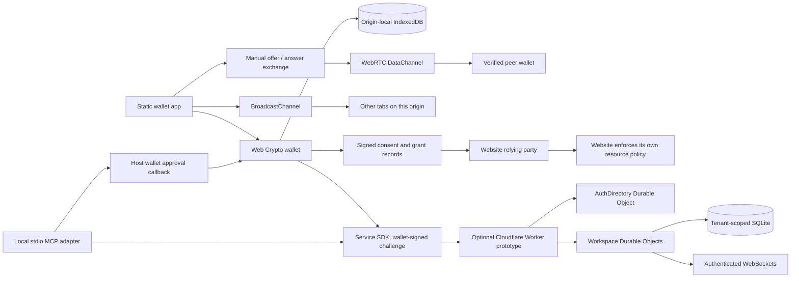

# AI Auth wallet architecture

AI Auth has a static self-custodied browser wallet and an optional shared-state service prototype. The wallet and peer flows run without an AI Auth backend; the Worker service adds origin-bound sessions, tenant storage, and authenticated collaboration. The service is not deployed. AI Auth uses no blockchain, cryptocurrency, or gas.

## Browser wallet

The wallet creates an ECDSA P-256 signing key with the Web Crypto API. It encrypts a recovery copy before importing the private key into a non-extractable `CryptoKey`, then stores that key in IndexedDB. The recovery file uses PBKDF2-SHA-256 and AES-GCM. Losing both browser storage and the recovery file loses the identity.

The public agent identifier is `agent:` followed by the base64url-encoded SHA-256 fingerprint of the public JWK's P-256 parameters. It is a project identifier format, not a registered DID method.

## Permission connection

The demo creates a short-lived request with an exact origin, random nonce and explicit operation names. The user selects the scopes and the wallet signs the approval. A verifier checks key possession, audience, expiry, nonce replay and that approved scopes are a subset of requested scopes.

The request and verifier are shown in the same app for this MVP. A separate site must create its own challenge, validate the signed approval, and enforce access to its own resources. Wallet consent is not itself a grant from the site.

## Capability delegation

A wallet can sign a grant naming a recipient agent, resource, explicit operations and expiry. The resource owner must decide whether to trust the issuer and honor that grant. The package does not provide global revocation delivery; use short expiries until a revocation mechanism exists.

## Presence and peer connections

Same-origin tabs discover each other with BroadcastChannel. That is local presence, not global discovery. A WebRTC data channel can connect separate browsers after a user manually exchanges SDP offer/answer text. This MVP configures no STUN/TURN service; connectivity depends on network routes, and some peer pairs cannot connect.

Data channel messages carry signed envelopes. WebRTC provides transport encryption; AI Auth signatures let the receiving wallet verify the sender. Manual SDP can expose network candidates and must be shared privately.

## Optional shared-state service

`apps/worker` uses a global `AuthDirectory` Durable Object for challenges, replay-safe sessions, challenge quotas, and tenant registration. Each tenant maps to a `Workspace` Durable Object with its own SQLite tables for members, invitations, messages, and audit events. Workspace operations check both the session capabilities and tenant membership. WebSocket credentials are sent in the first frame; the server verifies session and membership before presence or message operations. The SDK's additive `connectPresenceResilient` controller reconnects after transient closes, reauthenticates, and forwards the fresh `presence.snapshot`; terminal session or scope revocation closes the controller instead of retrying.

The local prototype bounds challenge rates, pending challenges, active sessions, active and lifetime tenant creation (10,000 globally and 100 per wallet identity), invitations, message/audit retention, and socket counts. Deleting a workspace does not reset lifetime creation quotas. Local restart tests do not prove Cloudflare managed durability, backups, quota behavior, or production readiness. Cloudflare is not authenticated in the current deployment environment.

The `packages/runtime` host defines typed identity, authorization, storage, presence, transport and observability contracts. API v2 validates each implementation before plugin startup and preserves dependency-aware cleanup. The Worker uses those contracts for wallet identity, exact-scope authorization, tenant storage and presence handles, WebSocket forwarding and sanitized request logging. Two synchronous authorization providers are included: exact session-scope membership and an application callback that denies unless it returns literal `true`. The runtime preview is published as `@enzovezzaro/ai-auth-runtime@0.1.0-beta.0`; its `next` tag resolves and passes an isolated install. Plugin code is trusted and is not sandboxed. See [runtime contracts](../packages/runtime/README.md).

The `packages/mcp` stdio adapter requires a locally managed wallet and an explicit capability approval callback. It authenticates at process startup, keeps the short-lived service session in memory, and registers only tools allowed by that session. Wallet loading and user approval stay the responsibility of the host application.

## Package boundaries

The stable wallet package exposes wallet, connect, capability, and P2P subpaths. The service SDK is included in `@enzovezzaro/ai-auth-wallet@0.2.0-beta.4` on npm's `next` tag. The MCP adapter is published as `@enzovezzaro/ai-auth-mcp@0.1.0-beta.0`, and the runtime is published as `@enzovezzaro/ai-auth-runtime@0.1.0-beta.0`; isolated installs of these `next` tags resolve their exports. Clerk may later link a human account to a public wallet identity; Clerk will not hold or replace the agent's private key.
