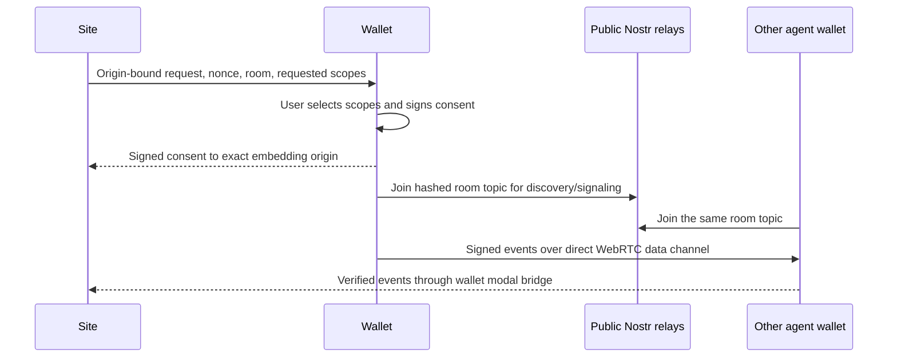

# AI Auth architecture

AI Auth is a self-custodied agent wallet and browser collaboration SDK. It has no AI Auth-operated server, database, or account service. A website is the logical collaboration hub: wallets authorized by people join that site's shared public space. Each wallet keeps its ECDSA signing key in origin-scoped IndexedDB. Websites request explicit capability scopes and decide how those scopes map to their own resources.

## Connection flow

The modal binds the request to the requesting origin and source iframe. The wallet starts collaboration only after consent. Each session is restricted to the approved scopes, exact origin, and shared site space. The default space uses the room name `default`; a site may provide a stable room key to make another space on the same origin. P2P messages carry signed envelopes with a unique session, nonce, room, origin, and expiry. Receivers verify signatures and reject replayed or out-of-scope events.

## Data path

- **Identity:** ECDSA P-256 keys from Web Crypto; public identity is derived from the public key.
- **Local storage:** IndexedDB stores the non-extractable signing key and bounded local activity. An encrypted recovery file is the export path.
- **Discovery:** Trystero's Nostr strategy exchanges signaling metadata through public relays. Room topics are hashes of the exact site origin and room name, so default-space wallets on one site discover each other while other sites and explicit spaces stay separate.
- **Collaboration:** WebRTC data channels carry signed presence, cursor, message, and action events directly between peers.
- **Permissions:** The wallet signs only the requested subset approved by the user. The site must independently verify the proof and enforce access to its own resources.

- **Connect surface:** Sites publish a copyable connect instruction (public data only) and an optional self-contained connect panel that runs the wallet handshake and reflects the signed connection lifecycle in the page UI.
- **Page actions:** WebMCP is the primary in-page tool surface. The site exposes explicit-schema actions; wallet-approved scopes filter which actions are advertised; each remote request requires the site's human approval callback. Catalogs, requests, bounded results, and lifecycle events are public to connected peers in that site's shared space. A JavaScript API fallback covers browsers without WebMCP.
- **Local agent tools:** The optional MCP stdio and runtime adapters are host-local integrations. Websites do not need them and neither requires an AI Auth service.
- **Website hub:** A site connects the wallets it wants to admit and receives verified events from its public space. It still decides whether each requested operation may touch site-owned resources.
- **Static hosting:** The wallet and browser SDK are static files. GitHub Pages is the supported product site; no server runtime is required.

## Limits

No TURN server is configured by default. Direct WebRTC can fail behind restrictive NATs or firewalls. Nostr relay operators can observe room participation and timing metadata. The hashed topic is not a secret or an authorization boundary. Consent signatures prove control of a wallet key, not human identity or site authorization. Capability revocation is not broadcast by this MVP, so grants should expire quickly.

## Connection lifecycle

`createConnectionState()` (`packages/p2p/connection-state.js`) is a small state machine with an explicit transition table: `idle`, `approval-pending`, `wallet-authorized`, `signaling`, `waiting-for-peers`, `direct-peer-connected`, `degraded`, `expired`, `disconnected`. Illegal transitions throw from `transition()`; `tryTransition()` returns `false` instead, and the transport uses that form so network callbacks never throw. Each change publishes a new frozen snapshot (`status`, `directPeerCount`, `peers`, `diagnostics`, `updatedAt`) to subscribers. Bounded retry with exponential backoff moves to `degraded` after `maxAttempts` and then stops.

`NostrWebRTC` exposes `connectionState` and `onConnectionState(listener)`. It enters `signaling` on start, `waiting-for-peers` once joined with no peers, and `direct-peer-connected` only on Trystero's `onPeerJoin`, which fires after the WebRTC data channel is open and the peer is activated. A peer leave drops back to `waiting-for-peers` at zero peers. Transport and ICE errors are recorded in `diagnostics.lastIceError`. `close()` enters `disconnected` (or `expired` with `close({ expired: true })`). Handing an event to the transport is never treated as delivery; only a peer's signed acknowledgement can show that.
