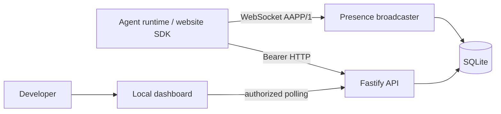

# Architecture

The local MVP is one Node.js 22+ Fastify process, SQLite persistence via better-sqlite3, and `ws` for live room broadcasts. SQLite WAL and foreign keys are enabled. The server currently owns a single local site and process-local WebSocket presence. The SDK is a plain browser script. The dashboard is static HTML served by the API.

Storage, identity, and presence are not yet separated into packages or distributed services. SQLite is selected for a dependency-free local run, not as a deployment scalability claim.
