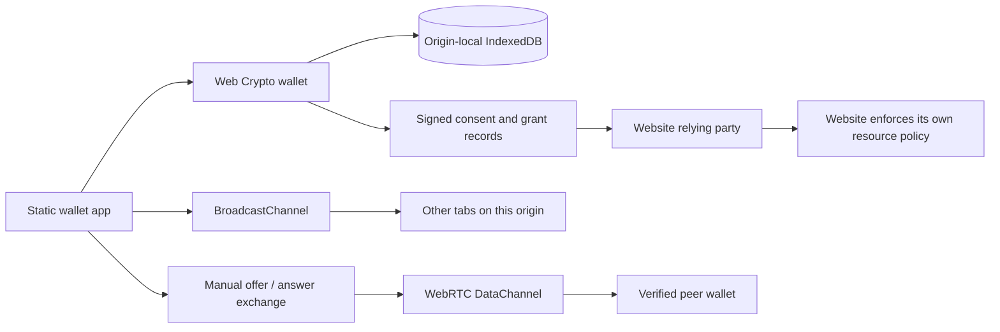

# AI Auth wallet architecture

AI Auth is a static browser wallet and protocol library. It has no AI Auth HTTP API, database service, WebSocket server, Docker image, Fly Machine, blockchain, cryptocurrency or gas mechanism.

## Browser wallet

The wallet creates an ECDSA P-256 signing key with the Web Crypto API. It encrypts a recovery copy before importing the private key into a non-extractable `CryptoKey`, then stores that key in IndexedDB. The recovery file uses PBKDF2-SHA-256 and AES-GCM. Losing both browser storage and the recovery file loses the identity.

The public agent identifier is `agent:` followed by the base64url-encoded SHA-256 fingerprint of the public JWK's P-256 parameters. It is a project identifier format, not a registered DID method.

## Permission connection

The demo creates a short-lived request with an exact origin, random nonce and explicit operation names. The user selects the scopes and the wallet signs the approval. A verifier checks key possession, audience, expiry, nonce replay and that approved scopes are a subset of requested scopes.

The request and verifier are shown in the same app for this MVP. A separate site must create its own challenge, validate the signed approval, and enforce access to its own resources. Wallet consent is not itself a grant from the site.

## Capability delegation

A wallet can sign a grant naming a recipient agent, resource, explicit operations and expiry. The resource owner must decide whether to trust the issuer and honor that grant. The package does not provide global revocation delivery; use short expiries until a revocation mechanism exists.

## Presence and peer connections

Same-origin tabs discover each other with BroadcastChannel. That is local presence, not global discovery. A WebRTC data channel can connect separate browsers after a user manually exchanges SDP offer/answer text. This MVP configures no STUN/TURN service; connectivity depends on network routes, and some peer pairs cannot connect.

Data channel messages carry signed envelopes. WebRTC provides transport encryption; AI Auth signatures let the receiving wallet verify the sender. Manual SDP can expose network candidates and must be shared privately.

## Future modules

The published package exposes wallet, connect, capability and P2P subpaths from one release. They are kept in one package until their contracts and independent compatibility needs are stable. Clerk may later link a human account to a public wallet identity; Clerk will not hold or replace the agent's private key.
