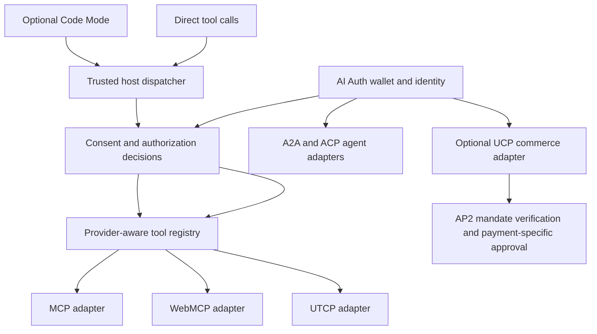

# RFC — Interoperable Agent Trust, Tool Adapters, and Optional Code Mode

**Status:** Proposed architecture / engineering handoff, not a shipped implementation  
**Date:** 2026-11-19  
**Repository baseline:** main at review time, verify again before coding  
**Target:** AI Auth as a server-optional, self-custodied identity + authorization layer across multiple tool, agent and commerce ecosystems.

## Executive recommendation

Do **not** replace working AI Auth identity, wallet, peer transport, WebMCP collaboration, or MCP integration. Add clean, independently testable provider boundaries. For tool invocation the supported provider families shall be **MCP / WebMCP / UTCP**. Code Mode is a **second, strictly optional orchestration interface** _above_ those providers, not a fourth protocol and not an identity provider. Agent-to-agent, editor-to-agent, commerce, and payments require separate adapters with distinct security invariants.

**Important existing functionality:** The current MCP package **already implements optional Code Mode** behind the CLI flag --code-mode; packages/mcp/bridge.js adds ai_auth_code only with that flag, and packages/mcp/code-mode-worker.js runs guest code through a Node worker and a vm context. docs/mcp.md documents the opt-in. Do not write another code execution engine by accident.

The new work is to audit/harden that code path, decouple invocation from any single provider, and evaluate whether code orchestrations may call allowed MCP/WebMCP/UTCP tools without bypassing native authorization.

### Product-level invariants

- The wallet owner controls key custody, scopes and consent. No required AI Auth account, hosted registry, blockchain, or proprietary authorization service.
- Identity, authentication, policy, delegated authority, discovery, connection, tool execution and payment authorization are **different** layers.
- A public DID/JWK or a signed message proves cryptographic control, not the authenticity of claimed model/provider, owner affiliation, or authorization to execute actions.
- A tool listed in a registry is _discoverable_, never implicitly approved.
- Native protocol authentication (e.g. OAuth for applicable HTTP MCP flows) **cannot be bypassed** by an AI Auth signature.
- Code Mode may only call **the same approved host dispatchers** available to explicit tool calls, with the same individual tool approval policy and stricter or equal resource budgets.
- Serverless identity does not mean universally serverless transport or payment settlement. Optional relay, TURN, OAuth, commerce and enterprise services must be declared as operational dependencies.
- Maintain legacy agent: identities, currently working DID aliases, P-256 keys, signed envelopes, grants, consent history, existing tools, and the ability to run with Code Mode **off**.
- Keep all provider adapters optional. A plain browser wallet should not transitively install Cloudflare Workers, QuickJS, commerce SDKs, or three tool client stacks.

## Code-grounded baseline (read before changing)

| Area                  | Existing code and behavior                                                              | Change intent                                                                                                      |
| --------------------- | --------------------------------------------------------------------------------------- | ------------------------------------------------------------------------------------------------------------------ |
| Existing local MCP    | packages/mcp/index.js, packages/mcp/bridge.js; stdio and loopback HTTP, scope approval  | Keep; adapt internal registry interfaces only if proven useful                                                     |
| AI Auth tool catalogs | packages/p2p/webmcp.js and packages/mcp/bridge.js (listTools, invoke)                   | Preserve signed catalog provenance, session, expiry, per-call site approval                                        |
| Optional Code Mode    | --code-mode in packages/mcp/cli.js; ai_auth_code registration in packages/mcp/bridge.js | Keep disabled by default, harden and gradually generalize                                                          |
| Code Mode worker      | packages/mcp/code-mode-worker.js (worker_threads and node:vm)                           | Audit sandbox boundary, limits, protocol and host-call accounting                                                  |
| Code Mode tests       | packages/mcp/test/code-mode-timeout.test.mjs                                            | Expand negative/boundary tests before expanding host capabilities                                                  |
| Identity portability  | packages/p2p/did.js, docs/DID.md, tests/did.test.mjs                                    | Additive; do not remove legacy agent: identity                                                                     |
| Existing plugin host  | packages/runtime/index.js; named core plugin slots                                      | Decide separately whether tool providers merit a multi-provider registry; don't force them into one-singleton slot |
| Transport             | packages/p2p/p2p.js and packages/agent                                                  | Keep Nostr + WebRTC by default; potential optional transport adapters                                              |
| Existing docs         | docs/ARCHITECTURE.md, SECURITY.md, BOUNDARIES.md, protocol.md, mcp.md                   | Keep normative contract and compatibility constraints intact                                                       |

This review inspects source and documentation; it does **not** claim current tests were executed, nor that proposed integrations work yet.

## Protocol taxonomy (do not conflate)

### Tool access — first-class adapters

| Protocol   | Responsibility                                                     | Runtime requirements                                                                      | AI Auth scope                                                                   |
| ---------- | ------------------------------------------------------------------ | ----------------------------------------------------------------------------------------- | ------------------------------------------------------------------------------- |
| **MCP**    | Tools/resources/prompts via official client/server transports      | StdIO locally; Streamable HTTP remotely; applicable MCP authorization rules               | Native adapter, preserve original schemas and OAuth/resource scopes             |
| **WebMCP** | Tools provided by the current browser/page context                 | Feature-detect the evolving W3C community API and site context; origin/lifecycle boundary | Existing browser adapter; never imply browser-native APIs where unavailable     |
| **UTCP**   | Describe/invoke native HTTP/other APIs without mandatory MCP proxy | Official TypeScript UTCP client/transports and native provider auth                       | Optional direct-call adapter, endpoint allowlist, SSRF/DNS rebinding protection |

**Do not** convert all tools into MCP servers. A direct UTCP provider may be called directly. The adapter layer should normalize _discovery + invocation metadata_ only, retaining native transport and authentication behavior.

### Agent communication and harness integration

- **A2A / Agent2Agent:** discovery, agent cards, tasks, messages, artifacts; optional signed cards and independent auth. Do not equate remote tasks with tool calls.
- **ACP — Agent Communication Protocol:** IBM/BeeAI predecessor absorbed into A2A; treat as legacy compatibility, not a simultaneous new standard.
- **ACP — Agent Client Protocol:** editor/IDE ↔ coding agent interface; orthogonal to A2A.
- **ACP — Agentic Commerce Protocol:** a _third_ unrelated acronym for commerce checkout; model it separately from the two above.
- Use adapter boundary for each; no automatic authority propagation between peers, editors, tasks and tools.

### Commerce and payment authority

- **UCP / Universal Commerce Protocol:** merchant capability discovery, commerce/checkout/order workflows, extensible payment integrations.
- **AP2 / Agent Payments Protocol:** verifiable payment-related mandates and evidence of delegated purchase intent/authorization.
- UCP and AP2 are **complementary**, not mutually exclusive. UCP AP2 mandate support should be evaluated against the exact extension version.
- Transaction-specific payment mandates must be isolated from generic tools.invoke, membership, A2A task permissions, and any scripted Code Mode call.
- Initial work is **research and sandbox fixtures only**, no real charge, wallet transfer, purchase, payment signing or issuer credential exchange.
- Verify mandate binding, audience, merchant, amount/currency, permitted item(s), freshness, revocation, and human confirmation under current payment protocol rules.

### Identity and delegated authority

Study W3C DID Core; did:key / did:jwk community methods; W3C VC 2.0; RFC 7638/8785; JOSE; OAuth/DPoP/token exchange; UCAN vs Biscuit; optional SPIFFE workload identity. None of these automatically substitutes for native MCP OAuth or payment mandates. Keep identity server-optional and algorithm agile. Use existing DID implementation as starting point, not a reimplementation target.

## Proposed architecture (conceptual, not current shipped module design)

The diagram does **not** mean Code Mode is permitted to invoke every visible tool. The trusted dispatcher must enforce identity, scope, origin, resource, session, audience, per-tool approval, credential boundary, and risk classification **for each invocation**. For commerce/payment use a separately gated dispatcher.

## Tool provider contract — proposed internal API

The council must validate this shape against existing code and actual client SDKs before implementing.

- providerId, protocol: mcp | webmcp | utcp
- discover(context) → immutable, namespaced descriptors + native source metadata
- listTools(context) → authorization-filtered view; do not expose secrets in descriptions
- invoke(descriptor, input, context, signal) → result preserving native error semantics
- cancel(callId) and close(), only where supported
- context = { callerIdentity, origin, audience, resource, room, session, delegatedProof, consent, transportAuth, riskPolicy, traceId }
- descriptor = { providerId, protocol, nativeId, name, inputSchema, description, sideEffects?, source, endpoint, expiry?, nativeMetadata }
- stable composite IDs prevent colliding tool names across site, agent, UTCP API and MCP server
- never silently translate unrecognized native authorization semantics into an AI Auth capability
- never give a model raw opaque OAuth tokens, API keys, payment credentials or unrestricted fetch access

Required invocation pipeline: provenance → freshness → argument validation → issuer/credential checks → native auth → AI Auth scope + policy → per-action user/site approval → native execution → bounded result + audit metadata. Specific order may differ per protocol but **all applicable checks must occur**.

**Policy decision and policy enforcement must remain in the host**, not guest-supplied generated code. Tool descriptions are untrusted content. A discovered tool must not grant authority to register new tools or override policies.

## Code Mode research and integration decision

### What Code Mode is

Code Mode is **programmatic tool calling**: a model submits a short script that calls typed, narrow host tool APIs, optionally combining several calls, filtering large intermediate results and using loops/conditionals without round-tripping every response to the model.

Cloudflare originally demonstrated translating MCP tools to callable TypeScript APIs, with isolated execution; later work used two meta-tools (search/execute), progressive discovery and Dynamic Workers. Pi added opt-in codemode using a **QuickJS sandbox** plus dynamic tool search. Neither mechanism is a cryptographic identity or an alternative to MCP.

Sources:

- Cloudflare first article: https://blog.cloudflare.com/code-mode
- Cloudflare MCP Code Mode (Feb 2026): https://blog.cloudflare.com/code-mode-mcp/
- Current Cloudflare docs: https://developers.cloudflare.com/agents/tools/codemode/mcp/
- Cloudflare security research: https://research.checkpoint.com/2026/when-agentic-glue-melts/
- Pi docs: https://docs.pi.dev/latest/cli
- Pi 0.99.0 notes (QuickJS, opt-in): https://pi.dev/changelog/releases/0.99.0
- MCP programmatic tool calling guidance: https://github.com/modelcontextprotocol/modelcontextprotocol/blob/main/docs/docs/2026-07-28/develop/clients/client-best-practices.mdx

### What AI Auth already ships

In packages/mcp/bridge.js the registration of ai_auth_code is explicitly gated by codeMode. With --code-mode, a guest script can call aiAuth.status(), listTools(), events(), send(), move(), and invoke(). It cannot join, leave, act, import modules, or access ambient process/fetch APIs through the documented guest interface. The guest code limit is 8,000 characters and the host uses a roughly 2-second overall timeout. The host uses a Worker to terminate runaway continuations. Existing direct MCP calls remain registered.

**Security caveat:** Node vm plus a Worker in the same process is **not a strong security sandbox** for arbitrary adversarial model-generated code; the source itself acknowledges this. JSON-only bridges and guest-realm closures are useful defense in depth, not an isolation guarantee. Do not claim it is equivalent to Cloudflare Dynamic Worker isolation or Pi's QuickJS architecture.

**Behavioral caveat:** A 2-second timeout can stop _subsequent execution_ and abort cancellable in-flight calls; it cannot reverse an external side effect already committed by send(), move(), or invoke(). As of this branch the send bridge does pass the shared controller signal, and the hardened Code Mode reports `partial: true` with `rolledBack: false` after a timeout. `vm` plus a same-process Worker is still not a hard isolation boundary, so sandbox red-team review remains a gate before expanding provider reach. (Reviewed and corrected 2026-11-19 against `packages/mcp/bridge.js`.)

### Recommended Code Mode profile

1. **Existing direct mode remains default.** No change to CLI default or consumers. An explicit opt-in capability/flag enables ai_auth_code.
2. **First step: security hardening, not a second engine.** Prove no vm escape, require trusted sandbox strategy for hostile guest code, bounded worker memory/CPU, per-tool approval, resource budgets, cancellations, and structured partial effects.
3. **Phase two: read-only progressive discovery**, typed generated schemas, stable namespace and tool description/search. Do not dump giant catalogs into the prompt. Exact method names/types should be derived from approved provider descriptors and _never_ bypass dispatch.
4. **Phase three: integrate MCP/WebMCP/UTCP** by dispatching each script call back through the common host policy boundary. Keep native auth/approval, network restrictions and transport semantics.
5. **Phase four: optional secure sandbox backend.** Compare maintaining worker+vm with QuickJS WASM, hardened subprocess, or externally isolated Worker using measurable threat model, latency, cost, portability and bundle size. Do not assume an external Cloudflare account or Workers service is required for AI Auth.
6. **Explicitly exclude payment mandates** and destructive/privileged operations from Code Mode initially. Reconsider only with per-action risk gates, transaction-specific consent and independently audited enforcement.
7. Provide per-call audit traces, bounded output and a reliable errors/partial-results model. Never report timeout as a clean rollback.

### Code Mode negative tests before expanded rollout

- ai_auth_code is absent unless flag on AND the necessary approved scope exists.
- Existing direct tools work identically when flag is off or on.
- Guest code cannot reach process, fs, network, environment variables, prototypes that escape the sandbox, or unrestricted module imports.
- Host dispatch rejects calls denied by native protocol authorization, per-origin/site policy, per-tool user approval or revocation.
- Per-tool counts, maximum output, code size, total requests, nesting, recursion, runtime, asynchronous continuations, logs and cancellation are bounded.
- Parallel tool calls require individual approvals; no permission aggregation or infinite fan-out.
- Script timeout aborts all still-cancellable host calls; committed side effects appear as partial results and are never automatically retried.
- Dynamic tool schemas cannot smuggle instructions or secrets into code execution or host logs.
- UTCP SSRF/private-address/DNS rebinding attempts fail even when initiated through Code Mode.
- Browser page destroyed: WebMCP invocation fails closed, never reuses a stale catalog/session.
- Same-name provider collision cannot redirect a call to an unintended site or account.
- Every high-risk or payment-capable action is excluded by default.
- Cross-version and multi-provider tests run with an independent MCP client and representative UTCP API; benchmarks include token, latency, cold-start and tool-call overhead.

**Release gate:** Until independent sandbox + policy red-team tests pass, keep Code Mode an opt-in, locally trusted agent convenience feature only. Do not advertise hostile multi-tenant isolation.

## Implementation sequence — one focused implementation PR per gate

**P0 — Baseline and inventory**

- [ ] Confirm current exports, tests and branch head; discover already implemented DID/Code Mode functionality.
- [ ] Run npm run test:all, test:types, build, verify:packages, test:browser:e2e where supported. Record outputs.
- [ ] Inventory WebMCP and MCP catalog data provenance and current grants.
- [ ] Record standalone threat model for executing model-generated scripts with native tool side effects.
- **Exit:** Reproducible baseline, no breakage.

**P1 — Provider architecture ADR**

- [ ] Compare existing MCP and browser catalog abstractions with the proposed provider contract.
- [ ] Identify lowest-change extension point for UTCP; avoid breaking site catalogs or published package APIs.
- [ ] Decide typed schema conversion, versioning, provider lifecycle, namespacing and errors.
- [ ] Confirm protocol version, license and actively maintained official SDKs.
- **Exit:** ADR with risk-managed incremental design; no rewrites without evidence.

**P2 — UTCP provider proof of concept**

- [ ] Integrate maintained official TypeScript UTCP client _optionally_.
- [ ] Native API calls without unnecessary MCP proxy.
- [ ] Enforce endpoint allowlist, DNS pinning/recheck or robust egress policy, no private-network access by default, credential isolation, schema validation and timeout/cancellation.
- [ ] Test authenticated and unauthenticated mock APIs plus attacker URL cases.
- **Exit:** Independent UTCP conformance and security results.

**P3 — Generalize trusted host dispatcher**

- [ ] Keep direct MCP/WebMCP behavior and native authorization.
- [ ] Add optional UTCP registry entries and distinct error codes.
- [ ] Apply per-tool policy checks, resource/audience binding and explicit scopes with no privilege widening.
- [ ] Prevent stale provider sessions, ambiguous names and untrusted catalog injection.
- **Exit:** Three provider types work via direct calls while existing integrations stay unchanged.

**P4 — Optional Code Mode hardening and extension**

- [ ] Demonstrate security under adversarial code, document VM threat assumptions and sandbox decision.
- [ ] Per-call authorization checked in host for MCP/WebMCP/UTCP.
- [ ] Progressive discover/describe methods and typing only for tools caller may use.
- [ ] Support bounded concurrent invocations with transparent partial side effects and cancellation.
- [ ] Reuse existing --code-mode and ai_auth_code; no new default tool and no second engine.
- **Exit:** Code Mode can compose read-only mock tools across all three adapters; direct mode regression tests pass.

**P5 — Agent and harness interoperability**

- [ ] A2A discovery/task/capability boundary; retain native authentication schemes.
- [ ] Evaluate Agent Client Protocol adapter for editor/harness applications.
- [ ] Explicit historical ACP and commerce-ACP distinction.
- **Exit:** Independent A2A client/agent interoperability without exposing unrelated tools.

**P6 — Optional commerce**

- [ ] UCP/AP2 versioned comparison and mocks; separate transaction mandate verification from AI Auth tool grants.
- [ ] Independent fraud, replay, wrong-merchant/amount and consent tests.
- [ ] Keep real payments out of CI and Code Mode.
- **Exit:** Safe design with no actual spending permissions.

**P7 — Production readiness**

- [ ] Threat model, conformance matrix, dependency security/licensing review, SBOM, observability, rollout/rollback and migration.
- [ ] No mandatory Cloudflare, OAuth service, registry or hosted signing backend for local self-custody flows.
- [ ] Evidence-backed performance benchmarks; compare direct tools and Code Mode with the same mock tasks.
- **Exit:** Security, interoperability, backwards compatibility and operational gates documented and passed.

## Specific reviewer decisions to resolve

1. Is the current Node worker+vm acceptable for trusted local scripting only, or must Code Mode migrate to an independently hardened runner before exposing UTCP/remote tools?
2. Should the first cross-provider Code Mode profile be **read-only only**?
3. How are caller identity, execution grant, native OAuth token and tool resource audience bound end-to-end without leaking credentials into guest JavaScript?
4. Should the tool registry be in packages/runtime, packages/agent or an optional new package to avoid importing Node SDKs into browser wallets?
5. How do WebMCP site lifecycle and catalog expiry map to the registry without losing browser-origin trust?
6. How does UTCP direct API invocation prevent SSRF and enforce native auth even through an agent-supplied manifest?
7. How do we trace partial effects and avoid unsafe auto-retries of timed-out multi-step scripts?
8. What independently measurable workloads justify Code Mode, and when is direct calling simpler/safer?

## Sources / verification targets

Official standards and projects, in addition to sources listed above:

- https://modelcontextprotocol.io/specification/
- https://webmachinelearning.github.io/webmcp/
- https://www.utcp.io/
- https://github.com/universal-tool-calling-protocol/typescript-utcp
- https://github.com/universal-tool-calling-protocol/utcp-mcp
- https://a2a-protocol.org/latest/specification/
- https://agentclientprotocol.com/
- https://ucp.dev/specification/overview/
- https://github.com/google-agentic-commerce/AP2
- https://www.w3.org/TR/did-core/
- https://www.w3.org/TR/vc-data-model-2.0/
- https://www.rfc-editor.org/rfc/rfc9449
- https://www.rfc-editor.org/rfc/rfc8693
- https://www.rfc-editor.org/rfc/rfc9421
- https://www.rfc-editor.org/rfc/rfc9420

**Source discipline:** Verify exact current spec status/version, implementations, licensing and APIs from primary sources. A blog, README or interoperability claim is a lead, not passing conformance evidence.

## Out of scope for this documentation-first PR

- Modifying the existing Code Mode runtime, worker, sandbox or CLI default.
- Shipping a UTCP client or adding dependencies before the provider/security ADR.
- Replacing MCP, WebMCP, Nostr/WebRTC, local wallet, DID alias or authorization proofs.
- Any real purchase, payment authorization, mandate signing or credential migration.
- Claiming tests ran or the architecture is already standard-compliant.

This RFC is a **concrete implementation brief**, not an instruction to merge speculative infrastructure.
