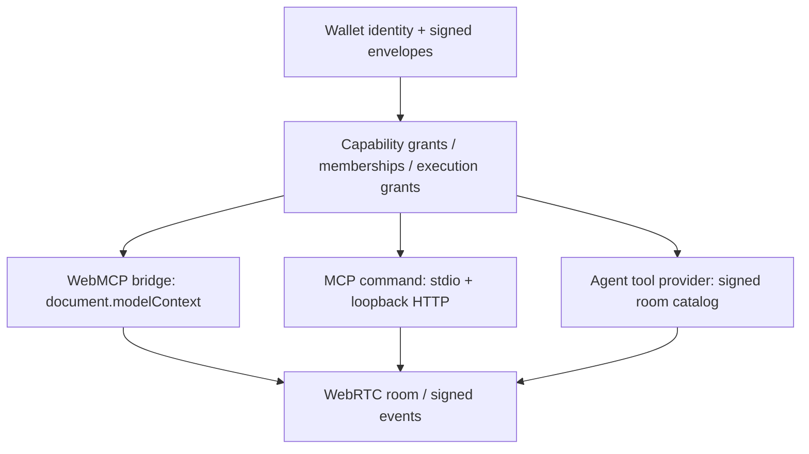
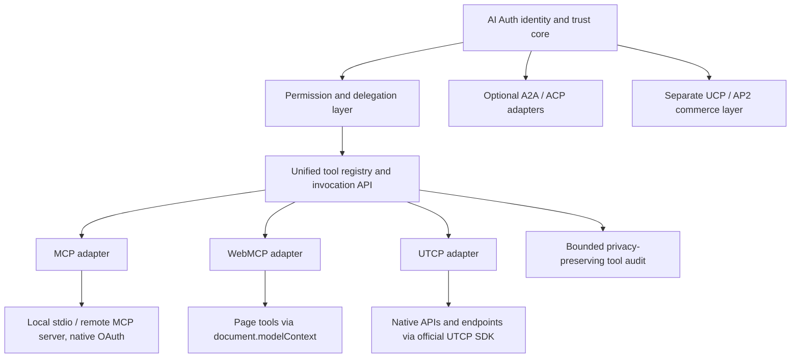

# Reference architecture

> Status: **proposed target architecture**. As-is facts cite repository files at `v0.11.1`. Proposed modules and interfaces are not implemented by this document.

## 1. Goal and non-goals

Goal: one AI Auth identity, permission and audit layer serving three first-class tool providers (MCP, WebMCP, UTCP), while preserving each provider's native authorization, transport and lifecycle semantics.

Non-goals: a new tool protocol, a new agent communication protocol, a new identity standard, a payment authority layer, a hosted registry, and a breaking identity or wire migration.

## 2. As-is layering



Three independent catalogs share only a wire convention. There is no registry, no protocol field and no source tracking. Evidence: `packages/p2p/webmcp.js`, `packages/mcp/bridge.js`, `packages/agent/tool-provider.js`, `packages/p2p/p2p.js`.

## 3. Proposed layering



The identity core and the registry are separate. The registry consumes identity facts; it never mints transport credentials.

Optional Code Mode sits above the registry as a second execution interface. It may reach a tool only through the same host dispatcher used by direct calls, with the same per-call checks. It adds no protocol, identity or authority of its own. Evidence and hardening gates are in `docs/CODE_MODE_COMPARISON.md` and `docs/INTEROPERABILITY_CODE_MODE_RFC.md`.

## 4. Trust boundaries

| Boundary                  | As-is                                                                         | Proposed rule                                                                                                                                  |
| ------------------------- | ----------------------------------------------------------------------------- | ---------------------------------------------------------------------------------------------------------------------------------------------- |
| Wallet ↔ site             | Signed consent bound to exact origin (`packages/p2p/index.js`, `SECURITY.md`) | Unchanged. A capability grant is not a resource grant.                                                                                         |
| Site ↔ agent              | Signed `agent/action` events over WebRTC                                      | Unchanged. Peer data is untrusted.                                                                                                             |
| Page ↔ tool (WebMCP)      | Page origin, `authorize` callback, `tools.invoke`                             | Keep the three draft gates (embedder `allow`, provider `exposedTo`, consumer `fromOrigins`); never claim browser privileges the adapter lacks. |
| Agent ↔ MCP server        | Secret loopback URL; no OAuth                                                 | Pass through MCP's native auth untouched. AI Auth scopes gate local tool registration only.                                                    |
| Agent ↔ UTCP endpoint     | None today                                                                    | Destination allowlist, HTTPS/literal-loopback rule, DNS-rebinding check, credential namespace isolation, cancellation wrapper.                 |
| Tool description ↔ policy | Descriptions are advisory (`webmcp.js`)                                       | Description text is never an instruction or a permission source.                                                                               |
| Tools ↔ commerce          | None today                                                                    | Hard separation. `tools.invoke` cannot authorize spending.                                                                                     |

## 5. Proposed module map

All paths below are **proposed**, except the existing files noted as such.

| Module                           | Path                              | Responsibility                                                                                        |
| -------------------------------- | --------------------------------- | ----------------------------------------------------------------------------------------------------- |
| Canonical identity (existing)    | `packages/p2p/index.js`           | `identityFor`, `signEnvelope`, `verifyEnvelope`. Keep `agent:` canonical.                             |
| DID alias (existing)             | `packages/p2p/did.js`             | Additive `did:key`, not an attestation.                                                               |
| Trust core (proposed facade)     | `packages/p2p/trust-core.js`      | Read-only view of verified identity, owner relationship, grants, revocation state. No new key format. |
| Tool descriptor (proposed)       | `packages/p2p/tool-descriptor.js` | Protocol-neutral descriptor builder and validator.                                                    |
| Registry (proposed)              | `packages/p2p/tool-registry.js`   | Namespaced registration, source tracking, capability matching, policy hooks, bounded audit.           |
| Invocation API (proposed)        | `packages/p2p/tool-invoke.js`     | `listTools`, `getTool`, `invoke`, `cancel`, `close`.                                                  |
| MCP adapter (proposed)           | `packages/mcp/adapter.js`         | Wraps the official MCP SDK; preserves native errors and OAuth.                                        |
| WebMCP adapter (proposed change) | `packages/p2p/webmcp.js`          | Refactor existing bridge behind the adapter interface; keep `document.modelContext`.                  |
| UTCP adapter (proposed)          | `packages/p2p/utcp-adapter.js`    | Thin wrapper over `@utcp/sdk`; adds AI Auth destination policy.                                       |
| Tool audit (proposed)            | `packages/p2p/tool-audit.js`      | Bounded records: caller, provider, protocol, tool id, decision, outcome. No payloads or secrets.      |

## 6. Proposed tool descriptor

```ts
interface UnifiedToolDescriptor {
  id: string; // e.g. "utcp:manual:github/issues.search"
  protocol: "mcp" | "webmcp" | "utcp";
  providerId: string;
  source: { origin?: string; endpoint?: string; page?: string };
  name: string;
  title?: string;
  description: string; // untrusted text
  inputSchema: object;
  outputSchema?: object;
  capabilities: string[]; // AI Auth scopes required
  risk: {
    sideEffect: "read" | "write" | "consequential";
    untrustedContent: boolean;
  };
  audience?: { origins?: string[]; walletIds?: string[] };
  requiredAuthorization: {
    kind: "owner" | "site" | "native" | "none";
    detail?: string;
  };
  availability: "online" | "offline" | "expired" | "unknown";
  native: object; // preserved original descriptor, never weakened
}
```

Rules: the native descriptor is preserved verbatim; unsupported native semantics are never translated into a weaker generic field; IDs must be namespaced by protocol plus provider.

## 7. Proposed adapter interface

```ts
interface ToolProviderAdapter {
  readonly protocol: "mcp" | "webmcp" | "utcp";
  discover(): Promise<UnifiedToolDescriptor[]>;
  listTools(): Promise<UnifiedToolDescriptor[]>;
  getTool(id: string): Promise<UnifiedToolDescriptor | undefined>;
  invoke(
    id: string,
    args: unknown,
    ctx: InvocationContext,
  ): Promise<InvocationResult>;
  cancel?(requestId: string): Promise<void>; // only where the protocol supports it
  subscribe?(onChange: () => void): () => void;
  close(): Promise<void>;
}
```

`invoke` receives the verified caller identity, delegated authority, origin, session, intended resource and protocol-specific context. `InvocationResult` keeps native error codes alongside a normalized outcome.

## 8. Required invocation flow

1. Discover the provider.
2. Validate provenance against the local trust policy.
3. Parse the native tool definition.
4. Register a namespaced descriptor.
5. Match the request to approved capabilities.
6. Validate target origin, resource and arguments.
7. Apply local security policy (deny by default).
8. Require owner or site approval where applicable.
9. Invoke through the native adapter.
10. Normalize success/error without discarding native detail.
11. Record bounded audit metadata.
12. Handle cancellation, timeout, expiry and disconnect.

Tool availability never implies permission. A tool's description is data.

## 9. Migration strategy

| Phase | Change                                                 | Breaking?                                                    |
| ----- | ------------------------------------------------------ | ------------------------------------------------------------ |
| M0    | Baseline tests and code inventory                      | No                                                           |
| M1    | Add descriptor and registry modules; no callers yet    | No (additive exports, docs updated with the BOUNDARIES list) |
| M2    | Route existing WebMCP catalog through the registry     | No, wire shape unchanged                                     |
| M3    | Add MCP adapter alongside the existing command         | No                                                           |
| M4    | Add UTCP adapter behind an opt-in flag                 | No                                                           |
| M5    | Cross-provider policy and audit                        | No                                                           |
| M6    | Additive identity adapters (VC/DID proof verification) | No                                                           |
| M7    | Delegation experiments in a separate package           | No                                                           |
| M8    | A2A/ACP adapters                                       | No, optional                                                 |
| M9    | UCP/AP2 layer with mocks/sandbox only                  | No, optional                                                 |
| M10   | MCP 2026-07-28 revision migration                      | **Yes** — separate compatibility decision and approval       |

Rollback: each milestone is a small commit behind a flag where user-visible, with the previous catalog path retained until conformance tests pass.

## 10. What remains unresolved

- Whether to expose unified registry exports from the root package or only through subpaths. `docs/BOUNDARIES.md` pins the live export list (DTC-06), so this needs an explicit doc update.
- Whether UTCP cancellation should be wrapped with an `AbortSignal` above the SDK, given the SDK has no verified cancellation API.
- Whether MCP revision migration is justified by a concrete compatibility need; no evidence yet.
- Whether any standardized identity adapter is worth the resolver dependency before an external verifier requires it.
